

  

<h1 align="center">CodeDNA</h1>

<b>Persistent, evidence-backed project memory for AI agents.</b> 
Keep a project's rules, decisions and past mistakes tied to the real code they came from — and see when the code has outgrown them.

  <a href="https://github.com/thisismohhey-dev/codedna-app/releases/latest/download/CodeDNA-Setup-0.1.0-win-x64.exe"><b>⬇ Download for Windows (installer)</b></a>
  &nbsp;·&nbsp;
  <a href="https://github.com/thisismohhey-dev/codedna-app/releases/latest/download/CodeDNA-0.1.0-win-x64.zip">portable .zip</a>
  &nbsp;·&nbsp;
  <a href="https://github.com/thisismohhey-dev/codedna-app/releases">all releases</a>

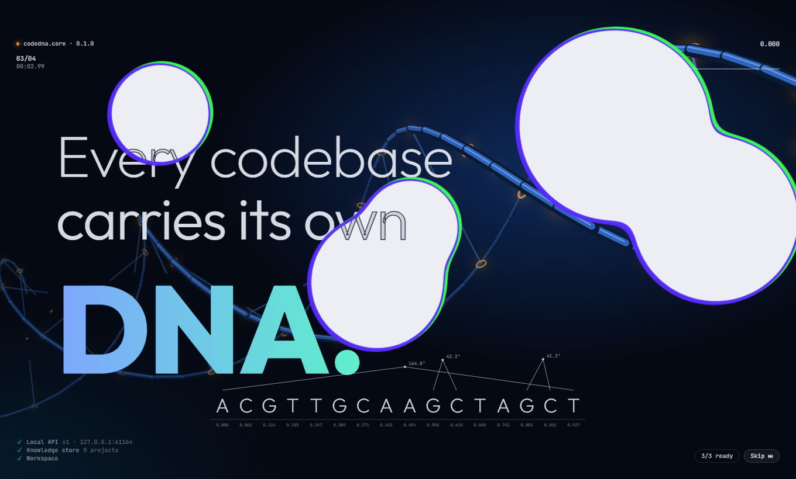

> **Version 0.1.0 — an early build.** It works end-to-end on real repositories, but whether it actually saves an agent tokens or time is **not yet measured**; the app ships the tools to measure it yourself (see *Measure* below).

## Download

| File | Size | SHA-256 |
|---|---|---|
| [`CodeDNA-Setup-0.1.0-win-x64.exe`](https://github.com/thisismohhey-dev/codedna-app/releases/latest/download/CodeDNA-Setup-0.1.0-win-x64.exe) | 123 MB | `1f5df0839e98f6bcad754cd124935bd9057a15f134866cb32f9c4c7c8c2aa0cc` |
| [`CodeDNA-0.1.0-win-x64.zip`](https://github.com/thisismohhey-dev/codedna-app/releases/latest/download/CodeDNA-0.1.0-win-x64.zip) (no install — unzip and run `CodeDNA.exe`) | 155 MB | `48f394b87b2475c3ace690dbf7eee0b2fa8d10a208daf08ea8befd107b537253` |

Verify a download in PowerShell: `Get-FileHash .\CodeDNA-Setup-0.1.0-win-x64.exe -Algorithm SHA256`

**Requirements:** Windows 10/11, 64-bit. Tested on Windows 11. No other platform is built yet.

**About the Windows warning.** These builds are **not code-signed**, so Windows SmartScreen may say "unknown publisher" (*More info → Run anyway*). Check the SHA-256 above if you want to be sure the file is the one published here.

## The installer

The installer wears the same dark look as the app: branded sidebar, the app's accent colour on the progress bar, a per-user install with no admin prompt and no questions to answer.

| Welcome | Installing |
|---|---|
| 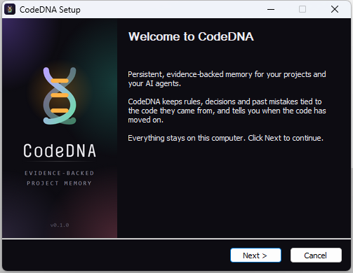 | 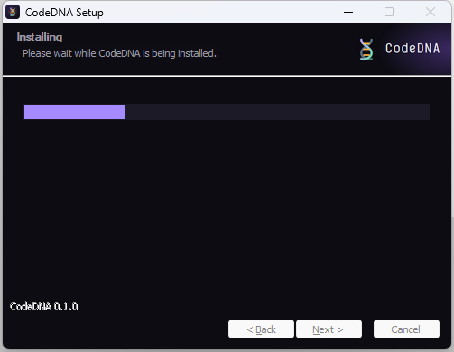 |
| **Ready** | **Uninstall** |
| 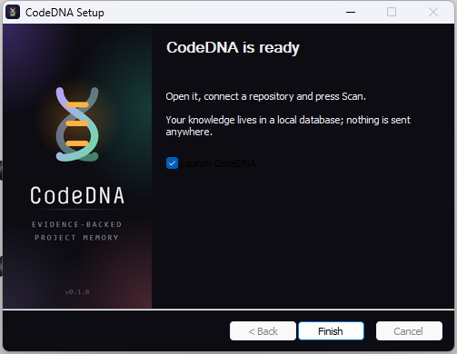 | 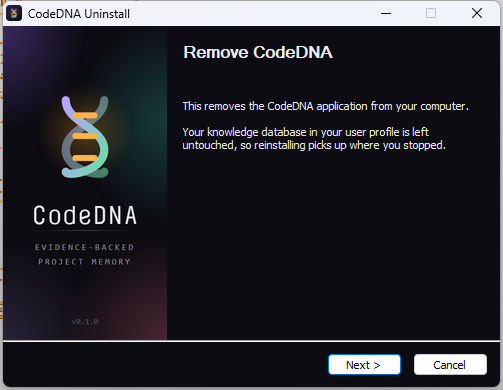 |

It installs to `%LOCALAPPDATA%ProgramsCodeDNA` and adds a Start-menu entry and a desktop shortcut. Uninstalling removes the application and leaves your knowledge database in `%APPDATA%CodeDNA` untouched. The standard Windows buttons keep the system look — Windows does not let installers recolour them.

## What it does

| | |
|---|---|
| **Scan** | Reads a repository locally (honours `.gitignore`, never opens `.env` or key files) and extracts files, symbols and import relations for TypeScript, JavaScript and Vue — including tsconfig aliases and workspace packages. Stores hashes and structure, not file contents. |
| **Remember** | Rules, decisions, known errors, how-tos — each with a **provenance** (`observed`, `declared`, `inferred`, `verified`) kept separate from its **freshness** (`current`, `stale`, `unverified`, `contradicted`, `historical`), and linked to real files or symbols as evidence. |
| **Notice change** | When linked code changes, the record turns **stale**, with the reason. Optionally the app rescans by itself when files change. |
| **Scope context** | For a task it returns only the relevant knowledge, with *why it matched*, how far to trust it, and explicit **unknowns** — never the whole memory. |
| **Analyze impact** | From a scan diff or chosen files: downstream files, affected knowledge with a confidence, suggested tests, and the analysis' blind spots. |
| **Verify** | Opt-in per project: run one plain command (for example your test command); the exit code, output tail and code fingerprint are stored as evidence. |
| **Measure** | Retrieval quality (precision, recall, MRR) on cases you label, plus baseline-vs-CodeDNA runs you enter yourself. No savings number is ever invented. |
| **Integrate** | A local HTTP API and an MCP server for agents. Anything an agent writes is stored as `inferred` and `pending`; agents cannot approve, verify, run commands or delete. |

## Tour

*(real app, demo repository `shop-api`)*

**Overview — what needs your attention**
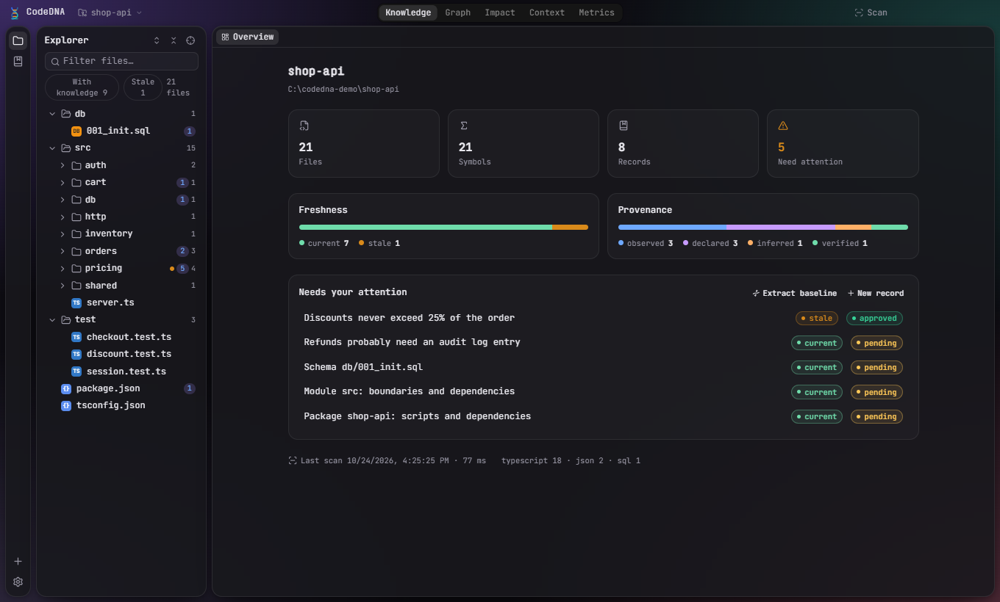

**Explorer and file view — symbols you can attach knowledge to**
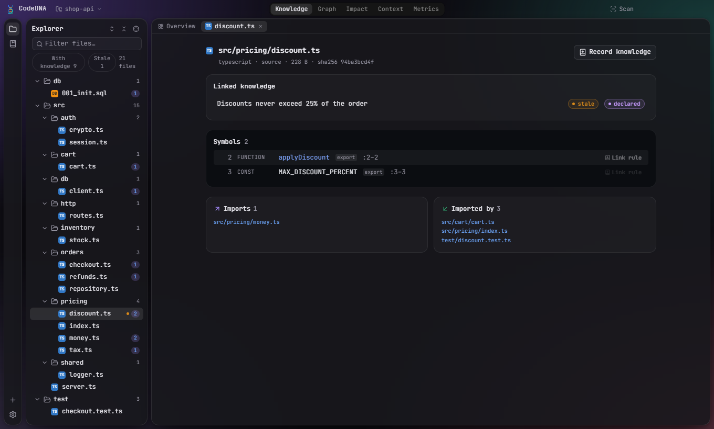

**A record that went stale because its code changed**
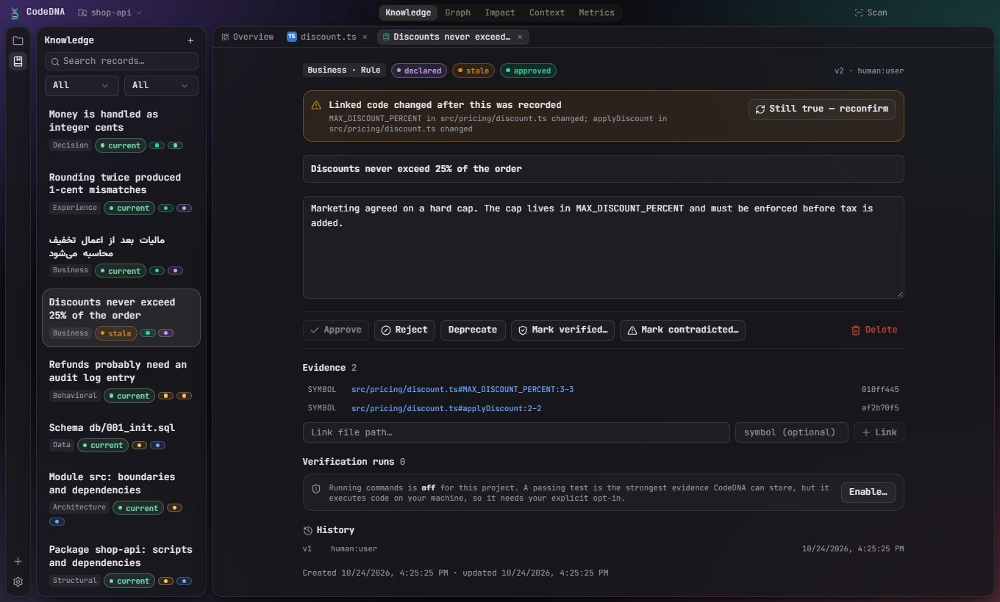

**Import graph — rings mark files that have linked knowledge**
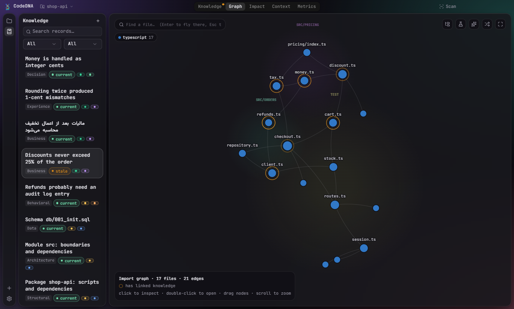

**Change impact — blind spots listed, never hidden**
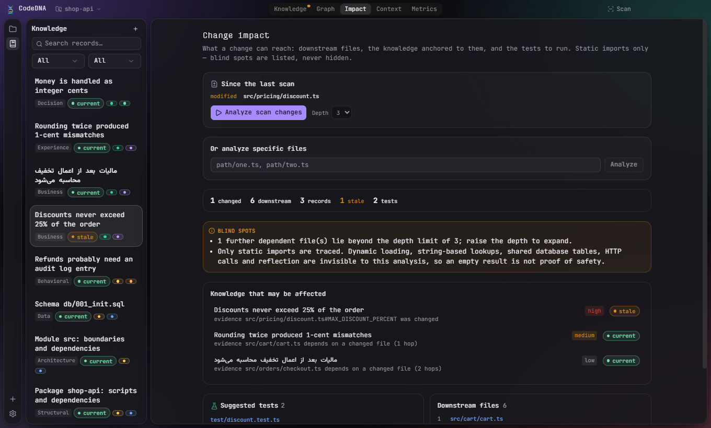

**Task-scoped context for an agent**
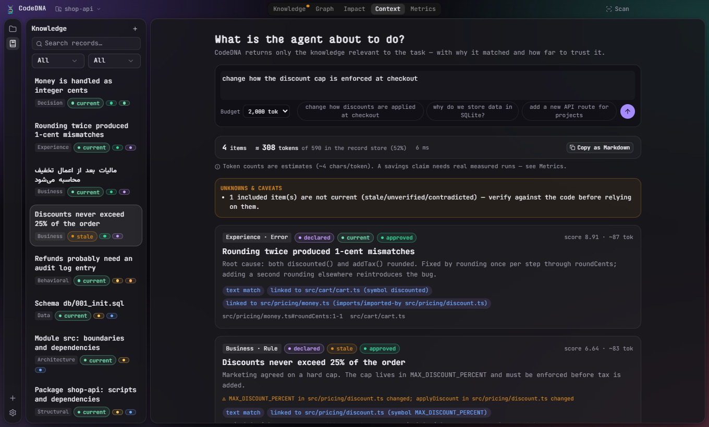

**Retrieval quality on your own labelled cases**
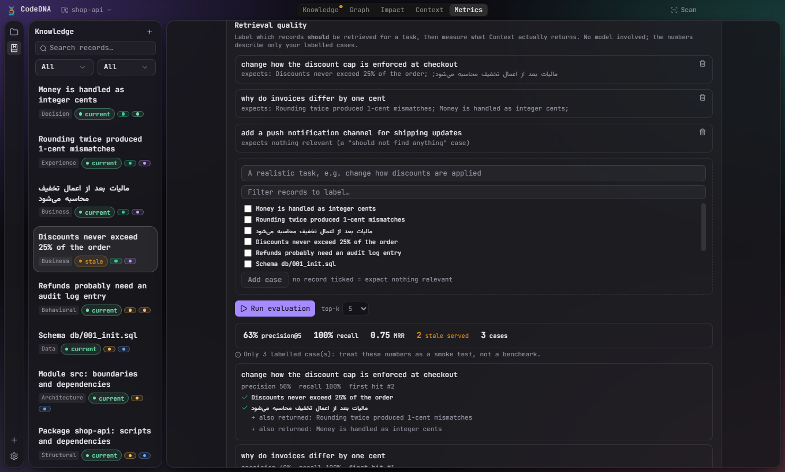

**Settings — palettes, light and dark, fonts, animation, backup**
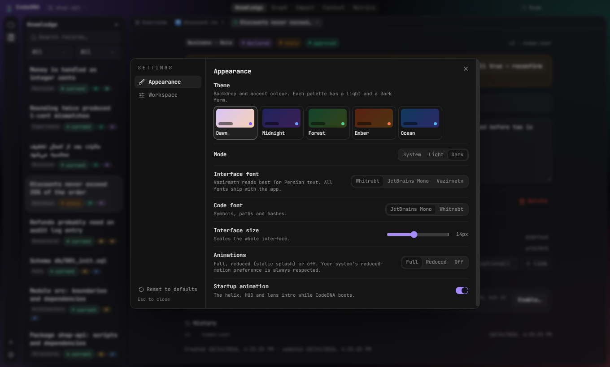

**Light mode, Ocean palette**
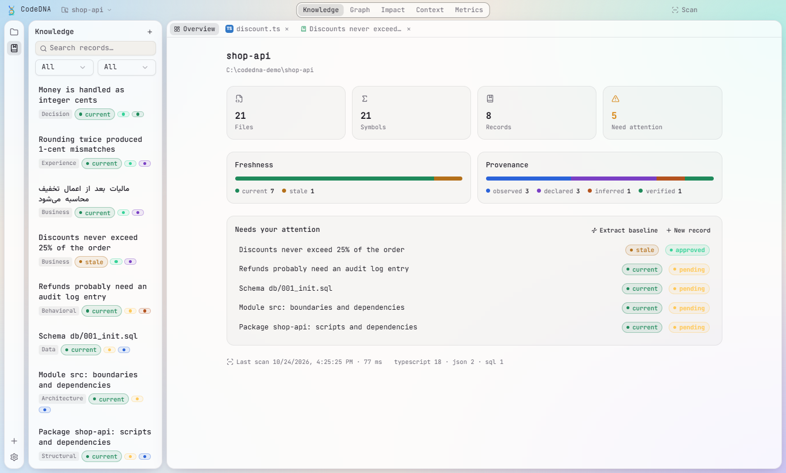

**Startup sequence** — a 3D helix, a mono HUD showing the real boot log, and metaball lenses that flip the headline into outlined type.

| | |
|---|---|
| 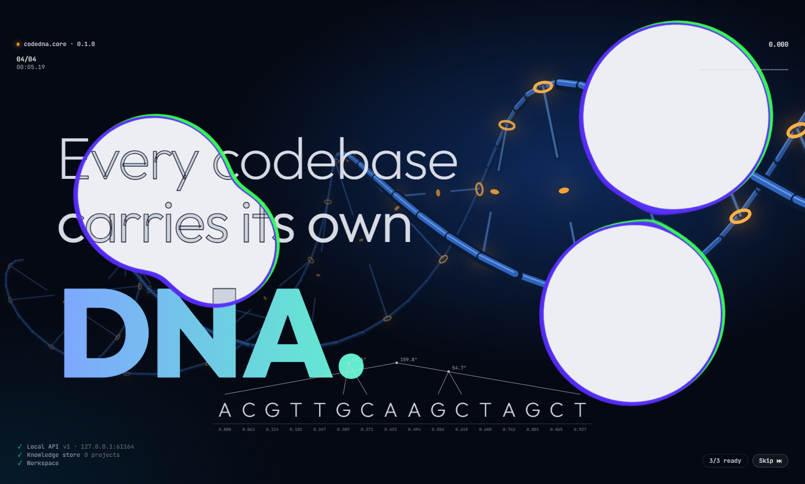 | 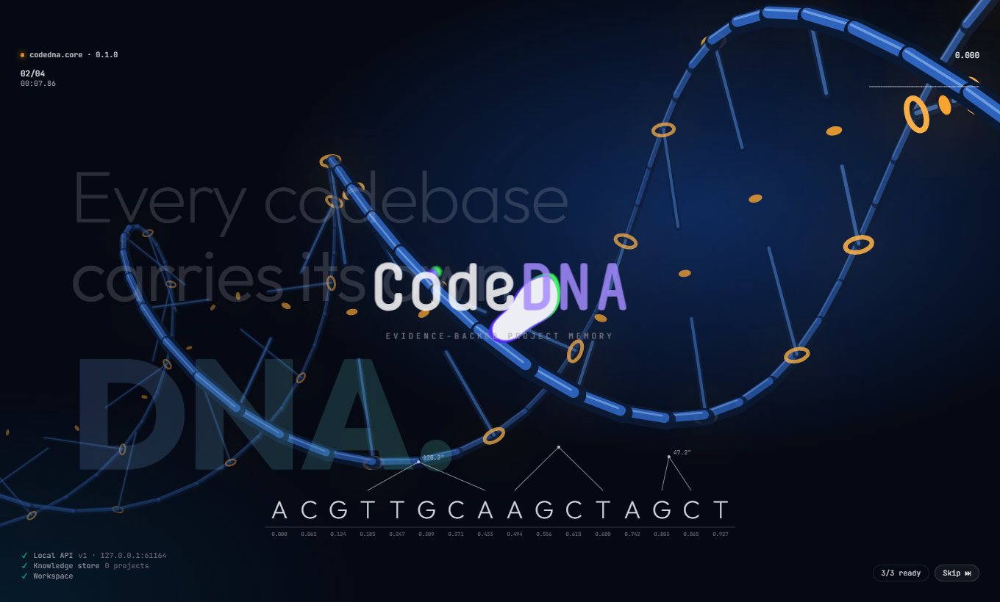 |

## Privacy and safety

- **Local only.** The app talks to itself on `127.0.0.1` with a per-launch token and makes no network requests of its own. Your knowledge lives in a SQLite file in `%APPDATA%\CodeDNA`.
- Secret files (`.env`, keys, credentials) are skipped and never read; file contents are not stored.
- **Running commands is off by default.** It is enabled per project, accepts a single plain command (no chaining, pipes or redirects), uses a minimal environment without your tokens, and has a 2-minute limit.
- Knowledge exported to or imported from a file is treated as untrusted by default (everything lands as `pending`).

## Honest limits

- Structure extraction covers TypeScript, JavaScript and Vue; other languages appear as files only.
- Impact analysis follows static imports only; dynamic coupling is invisible, and the app says so.
- Token figures in the app are estimates (about 4 characters per token).
- The interface is in English. Record text can be Persian or English.
- Builds are unsigned, Windows x64 only, with no auto-update yet.

## Source and feedback

This repository hosts the downloads and documentation. The source code is not published here. Questions and bug reports: open an [issue](https://github.com/thisismohhey-dev/codedna-app/issues).
